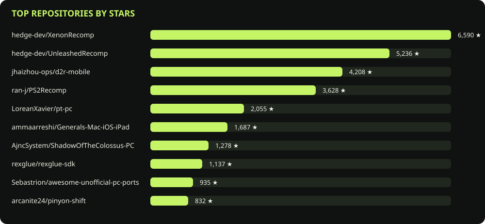

# Ports Lib

Living library of projects bringing console games to computers. The interface is available in Portuguese and English, with search, console/platform/type filters, and ranking by stars and activity. This index links to code and documentation; it does not host games.

Browse [games by title](https://scarin-corporations.github.io/ports-lib/web/games.html), including their source consoles, linked projects, and reported status.

## Live catalog and star chart

<!-- BEGIN LIVE CATALOG -->
<p><a href="https://scarin-corporations.github.io/ports-lib/">Open the Ports Lib app →</a></p>

**764 repositories indexed.** Search matches remain candidates until reviewed.



| # | Repository | Stars | Last push | Status |
|---:|---|---:|---|---|
| 1 | [hedge-dev/XenonRecomp](https://github.com/hedge-dev/XenonRecomp) | 6,556 | 2025-08-04 | Candidate |
| 2 | [hedge-dev/UnleashedRecomp](https://github.com/hedge-dev/UnleashedRecomp) | 5,189 | 2026-06-29 | Reviewed |
| 3 | [ran-j/PS2Recomp](https://github.com/ran-j/PS2Recomp) | 3,512 | 2026-10-14 | Candidate |
| 4 | [jhaizhou-ops/d2r-mobile](https://github.com/jhaizhou-ops/d2r-mobile) | 3,050 | 2026-10-15 | Candidate |
| 5 | [LoreanXavier/pt-pc](https://github.com/LoreanXavier/pt-pc) | 1,787 | 2026-10-15 | Reviewed |
| 6 | [ammaarreshi/Generals-Mac-iOS-iPad](https://github.com/ammaarreshi/Generals-Mac-iOS-iPad) | 1,673 | 2026-07-05 | Candidate |
| 7 | [rexglue/rexglue-sdk](https://github.com/rexglue/rexglue-sdk) | 1,079 | 2026-10-02 | Candidate |
| 8 | [Sebastrion/awesome-unofficial-pc-ports](https://github.com/Sebastrion/awesome-unofficial-pc-ports) | 900 | 2026-10-07 | Candidate |
| 9 | [SlickAmogus/silent-hill-decomp](https://github.com/SlickAmogus/silent-hill-decomp) | 679 | 2026-10-15 | Candidate |
| 10 | [sonicnext-dev/MarathonRecomp](https://github.com/sonicnext-dev/MarathonRecomp) | 674 | 2026-10-15 | Reviewed |
<!-- END LIVE CATALOG -->

## Development

Requer Python 3.12+. Sem dependências externas.

```sh
python -m unittest discover -s tests -v
python scripts/sync.py && python scripts/update_readme.py && python scripts/review_agent.py
python -m http.server 8000 --bind 0.0.0.0
```

Open `/web/` on the local server. Discovery uses `api.github.com`, takes about a minute, and returns an error if any query fails. `GITHUB_TOKEN` is optional locally and recommended for higher rate limits; configure it in the environment, never in source files. GitHub Actions uses its automatic token.

## Atualização e publicação

The workflow runs every six hours, manually, and on pushes to `main`. It tests, collects metadata, refreshes the README chart, reviews mapped game READMEs, and commits generated catalogs. For the website, an organization owner must enable **Settings → Pages → Build and deployment → Source: GitHub Actions**. Until Pages is enabled, catalog updates continue and deployment is skipped. The schedule runs on the default branch and can be delayed or disabled by GitHub after inactivity. Branch protection must allow bot commits or a future pull-request strategy.

Discovery searches console-specific terms and alternate names, recompilers, topics, native PC ports, and projects updated recently. It paginates GitHub results up to the API limit and reports any capped search. Search matches remain candidates until reviewed, so coverage and relevance still need community input. The README chart and list show the most-starred repositories found so far. Failed syncs preserve old data. Push dates indicate code activity, not a playable release. This version does not track star growth over time.

## Ranking and curation

`score = 20 × log10(stars + 1) + 30 × exp(-diasDesdePush / 180)`.

Public metadata includes stars, description, last push, license, and archive status. Traffic is unavailable for third-party repositories. Popularity does not prove quality. Automatically discovered projects remain **candidates** until reviewed; console and platform support must have evidence.

The review assistant refreshes [its evidence report](https://scarin-corporations.github.io/ports-lib/data/review-report.json) from public repository metadata and README text. A contributor checks the linked source, confirms the game and platform claims, and updates `data/curation.json`; the assistant never approves a project or tests a game. Use the [game suggestion issue form](https://github.com/scarin-corporations/ports-lib/issues/new?template=suggest-game.yml) to submit missing projects.

See [CONTRIBUTING.md](CONTRIBUTING.md), [project memory](docs/PROJECT_MEMORY.md), and [architecture](docs/ARCHITECTURE.md).

## Sponsorship

The repository funding link is prepared. Organization enrollment and payout approval are required before the Sponsor button can accept contributions; see [sponsorship setup](docs/SPONSORSHIP.md).
